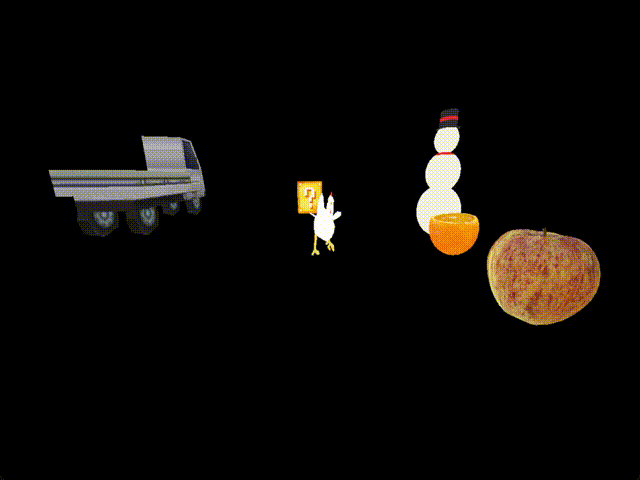
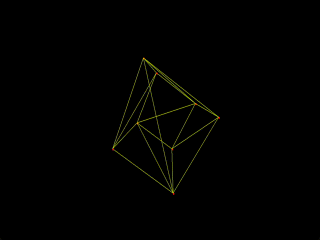
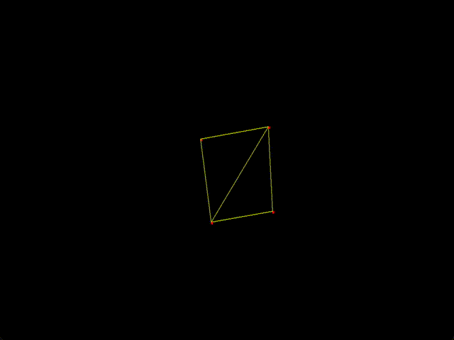
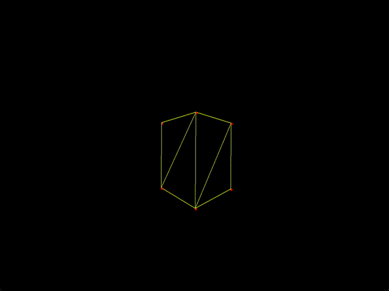
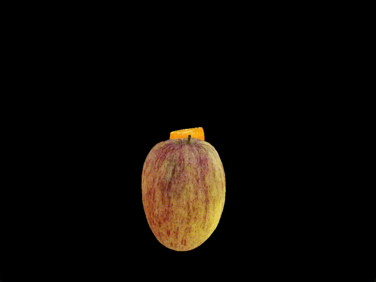
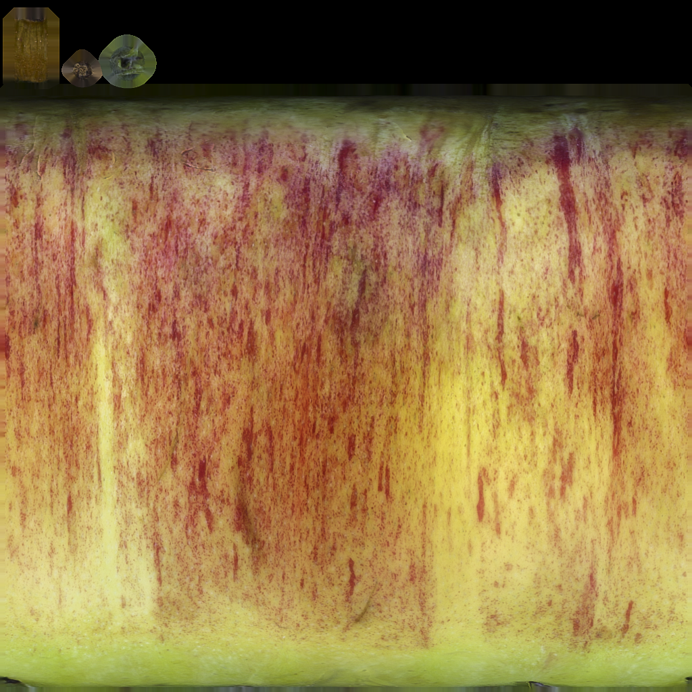
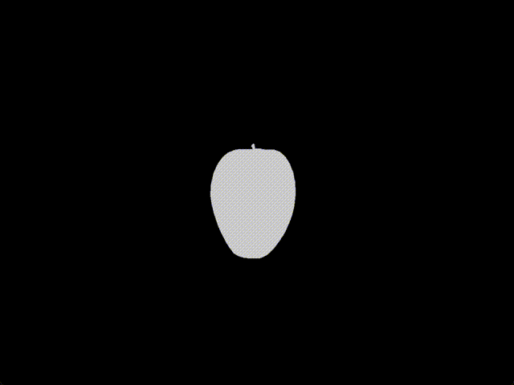

# CPU Based 3D Renderer

A cross platform CPU Based 3D Renderer I made for my college applications

This project is work in progress and not final including the readme


This README file contains information about my project, how it works, design choices I made and how to build the project.

If you want to know how the projects works I highly recommend checking the source codes, it has more explanations than the Readme

This project uses 2 libraries:
SDL3 for window initialization, displaying the contents of the framebuffer on the screen and STB_Image for image decoding. SDL3 is statically linked and stb_image is header only.

Models used: 
* https://sketchfab.com/3d-models/apple-3d-scan-aab2befcee1a448caaa62b21555e2017
* https://sketchfab.com/3d-models/orange-fruit-cbdf758f21924c168c1c3da1afed9754
* https://sketchfab.com/3d-models/low-poly-car-28f331c0db9d4eedbd1eeb8320fded4f
* https://sketchfab.com/3d-models/low-poly-snowman-3004f58fc16f4c818a4edc915aeed430
* https://sketchfab.com/3d-models/low-poly-chicken-2d0701a199924a9ca36e76759ceaeea6
* And a cube with texture made by Clayton Chowaniec (Luckyblock Texture)


## Table Of Contents

* [Features](#features)
* [Building the project](#building-the-project)
* [Controls](#controls)
* [Explanations](#explanations)


# Features
* A fully functioning rendering pipeline with optimizations that most 3D Renderers use
* .obj model support
* Texture support in various image formats, perspective correctness
* Clipping, backface culling
* A self made math library including vectors and matrices
* Transformation, view and perspective projection matrices
* Z buffer
* And much more




# Building The Project

If you want to build this project you need to have [CMake](https://cmake.org/) (Minimum Version 3.16) and a compiler that supports C++ 17.

Download or git clone the project then open your terminal inside the directory that has the main CMakeLists.txt and paste these commands in order.

```
cmake -S . -B build -DCMAKE_BUILD_TYPE=Release
cmake --build build --config Release
```

# Controls
* WASD to move around
* Q and E to go up/down (Regardless of which direction you are facing)
* Move your mouse to turn around
* 1-6 to change rendering mode which includes (Wireframe, Solid Fill, Textures and a combination of these)
* C to enable backface culling and V to disable it
* Tab to lock/unlock your mouse
* ESC to quit the application


# Explanations
These are general explanations and doesnt cover much, if you want to learn more about how this projects works you can check the source code which goes more in depth about how things work.

* [Rendering Pipeline](#general-rendering-pipeline)
* [Backface Culling](#backface-culling)
* [Clipping](#clipping)
* [Rasterization](#rasterization)
* [Z Buffer](#z-buffer)
* [Textures](#textures)


## General Rendering Pipeline
This is a general explanation of the rendering pipeline, you can find more in depth explanation of each step talked here after this part.

The rendering pipeline starts in model space. A good way to think of model space is to think of modeling apps such as blender, where you have your model and it has its local coordinates in there. Normally if you apply model matrix at model space we would get into world space. Since we dont have anything to do in model space we apply our model and view matrix together (in correct order since matrix multiplication isnt commutative) to get into the view space. In view space the "camera" is at the origin. Other vertices gets moved around in a way that would make the origin view where the camera is at and looking at.

We perform **backface culling** in view space. Backface culling allows us to skip processing triangles that are facing away from us. After backface culling we multiply our vertices by the projection matrix which gets us into the clip space.

As the name implies in the clip space we perform **clipping**. Clipping allows us to not render triangles that are not visible and its essential if an object starts to dissapear from our view. While clipping can be done before the clipping space its usually a bad practice because in the clipping space we can use inequalities such as -w <= x <= w to easily get the dot product.


 After clipping stage is done we perform **perspective divide** to our vertices. This puts our vertex positions into NDC (Normalized Device Coordinates). X and Y of our vertices are between [-1, 1] while Z is between [0, 1]. After putting it into NDC we perform **viewport projection** to get into the screen space where we then start to draw pixels.


## Backface Culling
We perform backface culling in the view space. For this example lets assume that we have a triangle with vertices A, B and C and we want to find out if the triangle is facing away from us. We first have to get a normal vector of the triangle. We can get the normal vector by using **cross product**. We will first have to get an edge vector. An edge vector is just a vector going from one edge to the other. For this lets define edge vector BA and CA as BA = (B - A), CA = (C - A). We take their cross product BA x CA which will give us the normal vector. Lets say **BA x CA = N**. Normally we would have to normalize (making it a unit vector) the vector but since for backface culling we only care about the **sign of the dot product** we can skip this and save us from doing extra computation. **It's important that the winding order (clockwise or counterclockwise) is correct.** If you do the wrong order you will get a vector pointing at the opposite direction of the normal. After that we need to find the vector that goes from our triangle to our camera. We can use vertex A for this. Normally we would have to do Camerapos - A but since in view space camera is at the origin we can simplify it and just get -A. And finally, we have to take the **dot product** of the normal vector and -A. If our angle is between 90 and 270 degrees that means its facing away from us. Remember that we can express dot prodcut as X dot Y = |X| * |Y| * sin(theta) theta being the angle between X and Y. If the triangle is facing away from us that means 90 < theta < 270. Since cos is negative between 90 and 270 that means that if our dot product is negative then the triangle is facing away from us, which we should skip rendering. This saves us a lot of performance by skipping having to multiply by projection matrix, doing clipping and triangle rasterization.



## Clipping
We perform clipping in the clip space. Clip space allows us to not render things that we cant see and render stuff we can partially see. We need to store all vertices that are inside the planes. In clip space, we can use inequalities to easily get dot product between the the plane and the vertex. If the dot product is positive or equal that means our vertex is inside the plane (lies inside if dot product is 0) and we can store it. **However**, if we go from outside the plane to inside the plane or vice versa we need to linearly interpolate between those two points to get a point that lies inside the plane. We can use the linear interpolation formula **I = Q1 + t(Q2 - Q1)** to get the point. In our case Q1 is the **previous vertex** while Q2 is the **current vertex**. **t** is between [0, 1] and we can find it using **t = previousDotProduct / (previousDotProduct - currentDotProduct)**. We then can plug Q1, Q2 and t to get the point and store it. For uvCoords we do the same thing but instead of Q1 and Q2 being previous and current vertex, Q1 and Q2 are previous UV coord and current UV coord. After clipping we get a polygon with n vertices. We then convert this polygon into multiple triangles.


## Rasterization
Triangles are used in computer graphics to render objects because they form a single flat plane and they are convex. This makes it easy to fill the triangles. I used [Pineda's Algorithm](https://www.cs.drexel.edu/~deb39/Classes/Papers/comp175-06-pineda.pdf) to fill the triangles with solid color and textures. For this example lets have a triangle with vertices A, B and C. Pineda's algorithm works by using edge functions. Edge functions are 2D cross product between the edge vector and (edge - position). First of all, we should have a bounding box of where the pixels that belong the triangle could be. We can easily determine a bounding box by using the vertices. The starting X of the bounding box is the smallest X of all the vertices. For example if A = (100, 200), B = (500, 300) and C = (900, 500) then the starting X is 100. For the end X of the bounding box its the max X of the vertices. The same thing applys to the min Y and max Y of the bounding box. After calculating the bounding box we check if each pixel is inside the triangle. To check if its inside, we need to have 3 edge functions, each edge function coresponding to its own edge vector. If all the 3 edge functions are positive that means that the pixel is inside the triangle and we should draw it.

There are some important optimizations we can do that will increase the performance. Edge functions are linear, that means instead of calculating 3 edge functions per pixel which involves cross product we can simply calculate edge functions at the begining and increment the edge function as we go to the next row/column.

For example if we have an edge function with edge vector B - A

**deltaEdgeCol = A.y - B.y**

**deltaEdgeRow = B.x - A.x**

This helps us optimize a lot, since instead of doing 3 cross products **per pixel** we can simply increment.

Another optimization we can use is traversing, while there are many ways to traverse the bounding box with Pineda's algorithm I chose a simple but effective approach. Instead of going from start X to end X every row we can optimize it. If we get inside the triangle and then leave that means for that row we have went over every single pixel thats inside the triangle. Instead of continuing we can simply skip to the next row.



## Z Buffer
If there are multiple triangles that are getting rendered the last triangle that gets rendered will always draw over the triangles that gets rendered before it. This is a problem since if we have 2 objects regardless of who is front the last object that gets renderer will always draw over. To prevent this we have z/depth buffer. Z buffer saves the depth ( 1 / depth in this project which I will get why later) and compares if the pixels depth that we are trying to draw is greater/less than the previous depth value that was drawn. 

In our pipeline, after we multiply our vertex (4D vector) by the projection matrix, we store the vertex z value that was in the view space (or in my case -z since Im using a right hand coordinate system) in w of our vertex.
To get depth of each pixel we can use barycentric coordinates(alpha, beta, gamma). Alpha = Area (Subtriangle(Alpha)) / Area(Triangle)  To find the areas, we can expand the triangle into parallelograms. We can then use cross product to find the area of the parallelogram  which will give Area((SubParallelogram) / 2) / (Area(Parallelogram) / 2) which we can simplify and say Area(SubParallelogram) / Area(Parallelogram). For a triangle with vertices A, B and C we can use cross product to find the area of it. Area of the triangle becomes (B - A) x (C - A). We are more interested in the inverse of it since we will have to divide the subarea with are of triangle with this per pixel later and division costs more than multiplication so we should get 1 / ((B - A) x (C - A)) and multiply instead. After getting the area of the triangle we can easily find alpha, beta and gamma using the edge functions we calculated in rasterization.

For example for alpha, **Alpha = EdgeFunctionAlpha * inverseAreaTriangle**

Here is the important part, depth itself is **not** a linear transformation, that means we cant directly use the depth. However its inverse, 1 / depth is linear. To get 1 / depth of a pixel we can do

**1 / Depth = 1 / depthA * alpha + 1 / depthB * beta + 1 / depthC * gamma**

With this we can get the inverse depth and if we want to we can divide by 1 to get depth. But for the Z buffer dividing by 1 would mean extra computation. For this project, Z buffer uses 1 / depth. That means if an object is closer to us 1 / depth is smaller and if its farther away from us the 1 / depth becomes smaller. We should also not forget to clear the depth buffer after all objects have been rendered. I clear it to 0 since I use 1 / depth in my Z buffer. This idea also applies to perspective correctness for textures.



## Textures
Textures use an image (png, jpg, etc) and use **UV Coordinates** to select a color from that image. UV coordinates are usually between [0, 1]. In this project the bottom left is the origin (0, 0), u increases as it goes right and v increases as it goes up. Each vertex **in a face** has its own UV Coordinates. To get the uv coords of a pixel we can do something similar to what we did for Z buffer and then use uv coords to pick a color in the texture.


However there is a problem. If we dont add perspective correctness the texture will start to look weird. To add perspective correctness:

First when calculating the interpolated UV coords we have to divide each part with the depth.

For example, **interpolatedU = u0 / depth0 * alpha + u1 / depth1 * beta + u2 / depth2 * gamma**

After getting interpolatedU and interpolatedV we must divide them by the inverse area of the triangle

**interpolatedU = interpolatedU / inverseAreaTriangle**

Perspective correctness is done. We can now map our uv coordinates to the texture by:

**textureX = interpolatedU * textureWidth** and **textureY = interpolatedV * textureHeight**

Then we can do **color = texture[textureY * textureWidth + textureX]**

However there is an issue with this, since UV coordinates are from [0, 1] and we are multiplying textureX and textureY by width and height it can result in us going out of bounds. To prevent this we should check if textureX and textureY are equal to textureWidth and textureHeight and if so subtract 1 from them.

After we do all of this textures can now work properly.



